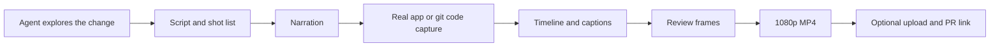

# PR Walkthrough

**Give your reviewer a video of the change.**

An agent skill and a small set of tools for making narrated pull request walkthroughs. The agent records your running app, explains the visible result, and renders a 1080p MP4. Changes without a UI get a before-and-after code walkthrough from real git revisions.

Built from the workflow we use at Diagonal. Works with any web application. No Laravel, Diagonal account, Linear integration, or upload service is required.

The original walkthrough skill and video pipeline were built by **[Craig Paul](https://github.com/craigpaul)**, with contributions from **[Owen Conti](https://github.com/owenconti)**, **[Lucas](https://github.com/harrisonlucaswork)**, and the Diagonal engineering team. See [Credits](CREDITS.md) for their work.

## Try it locally

You need Node.js 22+, Python 3.10+, FFmpeg (including `ffprobe`), and git. Python uses only its standard library. The browser is Playwright's bundled Chromium.

```bash
# macOS
brew install node python ffmpeg

# Ubuntu / Debian
# sudo apt-get update
# sudo apt-get install ffmpeg python3 espeak-ng
# Install Node.js 22+ using your preferred method.

npm ci
npx playwright install chromium
# On Linux, use: npx playwright install --with-deps chromium
npm run walkthrough -- doctor
npm run demo
```

The demo uses a bundled example app with synthetic data and free operating-system narration (`say` on macOS, `espeak-ng` on Linux). It writes:

```text
.walkthrough/demo/
├── out/saved-views.mp4
├── out/captions.srt
├── out/captions.vtt
├── out/script-with-timings.md
└── review/
    ├── sheet.png
    └── facts.md
```

Open `.walkthrough/demo/out/saved-views.mp4`. Nothing is uploaded. The output folder is git-ignored. To run another take, choose a new folder:

```bash
npm run demo -- --project .walkthrough/second-take
```

For a silent preview with no speech tool or API key:

```bash
npm run demo -- --project .walkthrough/silent-preview --provider silent
```

Captions are separate SRT and WebVTT files, not burned into the picture. Silent previews need a player that loads the caption file.

## Use it with your coding agent

The installable skill is [`skills/pr-walkthrough`](skills/pr-walkthrough/SKILL.md). Its instructions, scripts, examples, and dependencies are self-contained.

While this repository is private, users with access can clone it and copy that directory into your project's `.agents/skills/` folder, or into the skill directory your agent uses. Then install its dependencies:

```bash
cd /path/to/your-project/.agents/skills/pr-walkthrough
npm ci --workspaces=false
npx playwright install chromium
```

Ask your agent:

> Use the pr-walkthrough skill to make a 45–60 second video of this PR. Show the changed behavior in the running app. Use local narration and save the MP4 locally.

Or:

> Make a code walkthrough of this backend PR. Show the important code before and after, then the test that covers the change.

The agent needs terminal access and access to your local app. The scripts perform capture and rendering. The agent still explores your product, writes the narration, chooses selectors, and inspects the result. This is not a tool that turns an arbitrary diff into a finished video without that work.

Once this repo has a public GitHub URL, it can also be installed with the Skills CLI. See [publishing the repository](docs/publishing.md).

## Make a video of your app

You can also run the tools directly. From this checkout:

```bash
npm run walkthrough -- init .walkthrough/my-change
export WALKTHROUGH_PROJECT="$PWD/.walkthrough/my-change"
```

Edit the generated files:

- `video.json`: the audience, one message, and narration lines.
- `walkthrough.json`: your running app URL and optional setup hook.
- `scenes/main.mjs`: the real actions to record, one beat per narration line.

Then run:

```bash
npm run walkthrough -- narrate --provider local --dry-run
npm run walkthrough -- narrate --provider local
npm run walkthrough -- capture
npm run walkthrough -- review --footage
npm run walkthrough -- build
npm run walkthrough -- render --stills
# Inspect the review images before rendering the full video.
npm run walkthrough -- render
npm run walkthrough -- review "$WALKTHROUGH_PROJECT/out/my-change.mp4"
```

The default file name comes from the title in `video.json`. Use `render --name my-change` to choose it explicitly. A capture can be repeated; it replaces that clip. A failed capture removes the previous take so it cannot be used by mistake.

For an installed skill, use `node /path/to/pr-walkthrough/scripts/cli.mjs` in place of `npm run walkthrough --`.

## How it works



**The narration drives the timeline.** Each captured beat holds for its spoken line. The edit plays the footage at normal speed. Slow loading waits can be removed explicitly; meaningful actions stay on screen.

The default camera stays still. Cursor movement and a click ring make the action clear. Optional zooms and highlights need a stated reason and must pass the motion limits.

| Mode | Use | Target length |
| --- | --- | --- |
| `feature-clip` | One feature or bug fix | 30–90 seconds |
| `code-walkthrough` | A change without a visible app surface | 30–120 seconds |
| `product-walkthrough` | A longer flow with chapters | 2–4 minutes |

## Narration

| Provider | Credentials | Use |
| --- | --- | --- |
| `local` | None | Free narration with macOS `say` or Linux `espeak-ng` |
| `elevenlabs` | `ELEVENLABS_API_KEY` | Higher-quality narration with character timing |
| `silent` | None | Silent audio and timed caption files for previews |

ElevenLabs is the default for the `narrate` command; the demo explicitly selects `local`. Use `--provider` to choose. Paid requests use a shared cache and a per-project character budget. Run `--dry-run` before generating speech. See [narration and cost](skills/pr-walkthrough/references/narration.md).

## Adapt it to your project

- [App setup, login, fixtures, and capture API](skills/pr-walkthrough/references/capture.md)
- [Script format and presets](skills/pr-walkthrough/references/script.md)
- [Before-and-after code videos](skills/pr-walkthrough/references/code.md)
- [Rendering, review, and troubleshooting](skills/pr-walkthrough/references/rendering.md)
- [Optional publishing and PR workflow integration](skills/pr-walkthrough/references/publishing.md)
- [How Diagonal uses this pattern](docs/how-we-use-it.md)

App login and data setup belong in your project's hook. Use test data. The capture tools do not know your framework or application schema.

## Development

```bash
npm run check
npm run test:timeline
npm run test:audio
npm run test:narration
npm run test:contracts
```

CI also renders the bundled demo with local speech on Linux and keeps the output as a workflow artifact. No external account is needed. See [CONTRIBUTING.md](CONTRIBUTING.md).

## Scope

This release targets macOS and Linux. Windows support is not verified. Visual review still needs a person or a vision-capable agent: the media checks can detect format and timing problems, but cannot establish that your product behaves correctly. Uploads and GitHub changes are explicit actions.

MIT licensed. Created by Diagonal.
