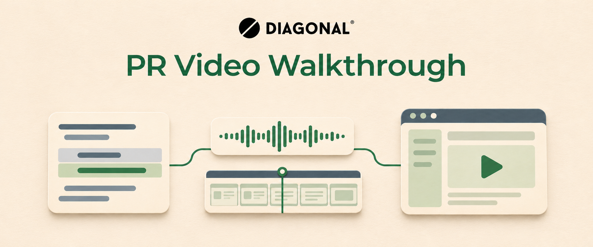

### Give your reviewer a video of the change.

Your coding agent records the real app, narrates the flow, and delivers a ready-to-review video. 
Backend change? Show the important code before and after.

Built by the [Diagonal](https://github.com/Diagonal-HQ) engineering team. Shared as a portable agent skill.

---

## Start here: copy this to your agent

Open your project in your coding agent and paste this prompt. It handles installation and project setup.

~~~text
Set up PR Video Walkthrough in this project:
https://github.com/Diagonal-HQ/pr-walkthrough

Read the repository README and skills/pr-walkthrough/SKILL.md first.
Follow this project's existing agent instructions and skill conventions.

1. Clone the repository into a temporary directory. It is currently private;
   use my existing GitHub authentication. If access fails, report that blocker.
2. Install the self-contained skills/pr-walkthrough directory in the skill
   location this project uses. Preserve any existing installation or customizations.
3. Check Node.js 22+, Python 3.10+, git, FFmpeg, and ffprobe. Install the skill's
   npm dependencies with npm ci --workspaces=false, then its Playwright Chromium.
   Follow this project's rules for installing missing system tools.
4. Add .walkthrough/ to the project .gitignore. Keep generated video, audio,
   screenshots, and browser auth state inside that ignored directory.
5. Find our local app URL, start command, test login, and fixture tools.
   Configure a walkthrough project and its setup hook using those conventions.
   If there is no useful app surface, configure the code-walkthrough preset.
6. Prefer ElevenLabs for final narration. Document how this project supplies
   ELEVENLABS_API_KEY without printing or committing its value.
   Use a free local or silent preview for setup checks.
7. Run doctor and a narration dry run from the application checkout.
   Add a short note to our agent instructions explaining how to request a video.

Do not make paid speech requests, upload media, push commits, or change GitHub
as part of setup. Tell me what you configured, what passed, and any blocker.
Finish by giving me the exact prompt to make a video of my next PR.
~~~

> **Private for now:** repository access is required. There is no Diagonal product account or framework dependency.

Once installed, ask for your first video:

~~~text
Use pr-walkthrough to make a 45–60 second narrated video of this PR for its reviewer.
Explore the change first. Show the real app behavior and the visible result.
For a change without a useful app surface, show real git code before and after.
Use ElevenLabs with our configured key, within the default character budget.
If it is unavailable, tell me before switching voices.
Review the video and save the MP4, captions, and transcript locally.
~~~

<strong>Make videos part of your shipping workflow</strong>

Add a short instruction to your shipping skill or `AGENTS.md` after installation:

~~~text
After validation, use pr-walkthrough to record a short video for the PR reviewer.
Film real app behavior for visible changes; use code slides otherwise.
Use the project's configured narration provider and budget.
Return the video, captions, transcript, and review result.
Publish and link the video only when this shipping workflow authorizes it.
If capture fails twice, record the blocker and continue the existing PR workflow.
Re-record affected beats if a later change alters what the video shows.
~~~

See [publishing and PR integration](skills/pr-walkthrough/references/publishing.md) for upload configuration and a PR description template.

## What you get

| **Show the product** | **Explain the code** | **Hand off the result** |
| --- | --- | --- |
| Record your running app with a visible cursor and click feedback. | Film readable, highlighted code from real base and head revisions. | Deliver a 1080p MP4, captions, a transcript, and review images. |
| Reuse your app's login and fixture tools. | Explain the failure, the fix, and the evidence. | Keep it local or publish through your existing PR asset workflow. |

**The voice sets the pace.** Generate narration first. Each recorded action gets enough time for its explanation, and the edit plays at normal speed. The camera stays still unless a measured readability problem needs a zoom or highlight.

~~~mermaid
flowchart LR
  A[Explore the change] --> B[Write the script]
  B --> C[Generate narration]
  C --> D[Record the real flow]
  D --> E[Render and review]
  E --> F[Share with the reviewer]
~~~

The agent does the product thinking: explore the flow, choose selectors, write accurate narration, and inspect the result. The tools handle capture, timing, captions, rendering, and media checks.

## Choose your voice

**Use ElevenLabs for a natural voice in the final video.** Free local narration is useful for checking the pipeline, but sounds synthetic.

| Provider | Best use | What you need |
| --- | --- | --- |
| `elevenlabs` | Final demos and reviewer handoffs | An exported `ELEVENLABS_API_KEY`; synthesis incurs cost |
| `local` | Free setup checks and quick iteration | macOS `say` or Linux `espeak-ng` |
| `silent` | A preview without spoken audio | No speech tool or API key; load the separate captions |

The ElevenLabs default is **Liam**, a conversational voice, with `eleven_multilingual_v2`. Voice and model settings are configurable. Paid requests use a shared cache and a per-project character budget. Run `--dry-run` before synthesis. See [narration and cost](skills/pr-walkthrough/references/narration.md).

## Try the complete example

The bundled example records a small task app with synthetic data. It filters the list, saves a named view, and shows the result.

From a clone of this repository, install **Node.js 22+**, **Python 3.10+**, **FFmpeg** (including `ffprobe`), and **git**, then run:

~~~bash
npm ci
npx playwright install chromium
npm run walkthrough -- doctor
npm run demo
~~~

On Linux, use `npx playwright install --with-deps chromium` and install `espeak-ng` for local narration. On macOS, `brew install node python ffmpeg` installs the system tools.

The default demo uses the free local voice. For the more natural ElevenLabs version, export your API key and select the provider explicitly:

~~~bash
npm run demo -- --project .walkthrough/demo-elevenlabs --provider elevenlabs
~~~

| Open the video | Inspect the evidence |
| --- | --- |
| `.walkthrough/demo/out/saved-views.mp4` | `.walkthrough/demo/review/sheet.png` |
| 1080p MP4 with narration | Contact sheet and media checks |

With the ElevenLabs command, replace `demo` with `demo-elevenlabs` in those paths. Captions and the timed transcript are beside the MP4. Nothing is uploaded. Use a new output folder for another take.

## Pick the right walkthrough

| Preset | Use it for | Target length |
| --- | --- | --- |
| **Feature clip** · `feature-clip` | One feature, bug fix, or PR | 30–90 seconds |
| **Code walkthrough** · `code-walkthrough` | A change without a useful visible surface | 30–120 seconds |
| **Product walkthrough** · `product-walkthrough` | A longer flow with chapters | 2–4 minutes |

## Go deeper

| I want to… | Read this |
| --- | --- |
| Set up login, fixtures, or browser capture | [App setup and capture](skills/pr-walkthrough/references/capture.md) |
| Write a clear script and shot list | [Script format](skills/pr-walkthrough/references/script.md) |
| Show a backend change | [Before-and-after code videos](skills/pr-walkthrough/references/code.md) |
| Tune the voice or control spending | [Narration and cost](skills/pr-walkthrough/references/narration.md) |
| Fix a render or review the result | [Rendering and troubleshooting](skills/pr-walkthrough/references/rendering.md) |
| Upload a video and link it on a PR | [Publishing and PR integration](skills/pr-walkthrough/references/publishing.md) |
| Understand the original workflow | [How Diagonal uses it](docs/how-we-use-it.md) |

<strong>Manual installation and commands</strong>

Copy [`skills/pr-walkthrough`](skills/pr-walkthrough/SKILL.md) into your project's agent skill directory. The entire folder is self-contained. Install dependencies from that installed directory:

~~~bash
npm ci --workspaces=false
npx playwright install chromium
~~~

In the application checkout, set `SKILL` to the absolute installed skill directory and initialize a project:

~~~bash
export SKILL="/absolute/path/to/your-project/.agents/skills/pr-walkthrough"
node "$SKILL/scripts/cli.mjs" init .walkthrough/my-change
export WALKTHROUGH_PROJECT="$PWD/.walkthrough/my-change"
~~~

Add `.walkthrough/` to the application's `.gitignore` first. Edit `video.json` for narration, `walkthrough.json` for the app URL and setup hook, and `scenes/main.mjs` for the actions.

~~~bash
node "$SKILL/scripts/cli.mjs" narrate --provider local --dry-run
node "$SKILL/scripts/cli.mjs" narrate --provider local
node "$SKILL/scripts/cli.mjs" capture
node "$SKILL/scripts/cli.mjs" review --footage
node "$SKILL/scripts/cli.mjs" build
node "$SKILL/scripts/cli.mjs" render --stills
# Inspect the stills before rendering the full video.
node "$SKILL/scripts/cli.mjs" render --name my-change
node "$SKILL/scripts/cli.mjs" review "$WALKTHROUGH_PROJECT/out/my-change.mp4"
~~~

From this repository's checkout, `npm run walkthrough --` is a shortcut for the CLI. Use `--provider elevenlabs` for paid narration with an exported API key. Captions are separate `.srt` and `.vtt` files; they are not burned into the picture.

<strong>Development and supported environments</strong>

~~~bash
npm run check
npm run test:timeline
npm run test:audio
npm run test:narration
npm run test:contracts
~~~

CI is configured to render the bundled demo with local speech on Linux and retain the result as a workflow artifact. Python uses its standard library. Browser capture uses Playwright's bundled Chromium. See [CONTRIBUTING.md](CONTRIBUTING.md).

This release targets macOS and Linux. Windows is not verified. A person or vision-capable agent still needs to inspect the video: media checks establish format and timing, not product correctness. Uploads and GitHub changes remain explicit actions.

---

## Built at Diagonal

The original walkthrough skill and video pipeline were built by **[Craig Paul](https://github.com/craigpaul)**, with contributions from **[Owen Conti](https://github.com/owenconti)**, **[Lucas](https://github.com/harrisonlucaswork)**, and the Diagonal engineering team.

This repo makes that workflow portable. No Laravel, Linear integration, Diagonal product account, or upload service is required.

**[Meet the contributors →](CREDITS.md)** · **[MIT license](LICENSE)** · **[Cover image art direction](docs/cover-image-prompt.md)**
